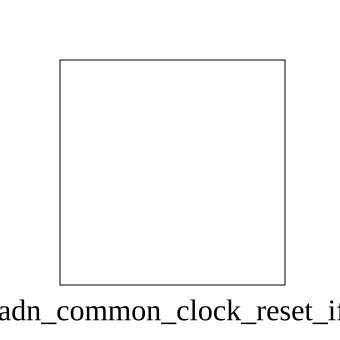

# adn_common_clock_reset_if (interface)

### Author: Foez Ahmed (foez.official@gmail.com)

### Source: adn_common_clock_reset_if.sv

## Top IO

## Parameters

|Name|Type|Dimension|Default|Description|
|-|-|-|-|-|
|RST_ACTIVE_LOW|bit||1'b1|1: Active-low reset; 0: Active-high|
|RST_START_ASSERTED|bit||1'b0|1: Starts asserted at time 0|
|RST_PRE_DURATION|realtime||100ns|Pre-reset delay before asserting reset|
|RST_DURATION|realtime||100ns|Duration reset is held active|
|RST_POST_DURATION|realtime||100ns|Post-reset stabilization duration|
|AUTO_APPLY_RST|bit||1'b0|1: Auto-apply reset at time 0|
|AUTO_APPLY_TIME|realtime||100ns|Time at which the reset should auto-apply if enabled|
|CLK_FREQ|real||100.0e6|Default clock frequency in Hz|
|DUTY_CYCLE|real||50.0|Default clock duty cycle percentage|
|CLK_PHASE|realtime||0ns|Initial clock phase / start delay|
|CLK_START_VAL|bit||1'b0|Initial value before clock starts|
|AUTO_START_CLK|bit||1'b0|1: Auto-start clock at time 0|
|AUTO_START_TIME|realtime||500ns|Time at which the clock should auto-start if enabled|

## Description

### Purpose
The `adn_common_clock_reset_if` interface provides a comprehensive, configurable SystemVerilog
simulation model and Bus Functional Model (BFM) for generating clock and reset signals. It
encapsulates clock frequency, duty cycle, phase offset, and active-low/active-high reset sequencing
into an intuitive, reusable interface for testbenches and verification environments.

### Use Case
This interface is primarily used in verification testbenches to eliminate boilerplate clock and reset generation logic. By providing standardized control tasks and functions (`start_clock`, `stop_clock`, `restart_clock`, `set_frequency`, `set_duty_cycle`, `apply_reset`, `apply_reset_cycles`, `wait_cycles`), verification environments can:
- **Simplify Testbench Setup:** Replace redundant `forever #half_period clk = ~clk;` and manual reset toggling with a parameterized, self-contained interface instance.
- **Dynamic Clock Control:** Dynamically adjust clock frequency and duty cycle during simulation to verify multi-rate designs, frequency scaling (DVFS), or clock gating behaviors.
- **Synchronous & Asynchronous Reset Generation:** Execute precise, glitch-free reset assertion and deassertion sequences defined by physical time delays or clock cycle counts.
- **Cycle-Accurate Synchronization:** Utilize built-in cycle counters (`clk_cycle_count`), edge alignment flags (`is_aligned`), and waiting utilities (`wait_cycles`, `wait_negedge_cycles`) for deterministic testbench stimulus and sampling.

| REVISION | DATE       | AUTHOR     | DESCRIPTION                                                 |
|----------|------------|------------|-------------------------------------------------------------|
| 0.1      | 2026-11-05 | Foez Ahmed | Initial version                                             |
| 1.0      | 2026-11-05 | Foez Ahmed | Stable release                                              |

Author : Foez Ahmed (foez.official@gmail.com)
